<div align="center">

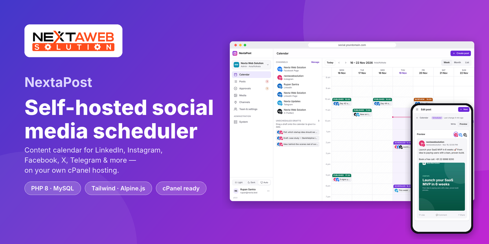

# NextaPost — Self-Hosted Social Media Scheduler & Content Calendar

**Plan, approve and publish posts to LinkedIn, Instagram, Facebook, X (Twitter), TikTok, YouTube, Pinterest, Threads, Google Business Profile, WordPress, Telegram, Discord, Mastodon and Bluesky from one calendar, on your own cPanel hosting. Let AI assistants schedule for you over MCP, or automate with the REST API.**

Built with plain **PHP 8 + MySQL + Tailwind CSS + Alpine.js**. No Docker, Node.js, Redis or monthly SaaS fees.

[](CHANGELOG.md)
[](#requirements)
[](#requirements)
[](#development)
[](#development)
[](#install-on-cpanel-about-5-minutes)
[](SECURITY-AUDIT.md)

[Features](#features) · [Screenshots](#screenshots) · [Supported networks](#supported-social-networks) · [AI & API](#ai-assistants-api-and-webhooks) · [Recommended hosting](#recommended-hosting) · [Install](#install-on-cpanel-about-5-minutes) · [FAQ](#faq)

<p>
  <sub>A product by</sub><br>
  <a href="https://nextawebsolution.com"><picture>
    <source media="(prefers-color-scheme: dark)" srcset="docs/brand/nexta-logo-dark.png">
    
  </picture></a>
</p>

</div>

---

## Why NextaPost?

NextaPost is a **self-hosted alternative to Buffer, Hootsuite and Postiz** for agencies, brands and small teams who want to own their social media workflow and data.

- 🗓️ **One content calendar for every channel**: week, month and list views with drag-and-drop rescheduling.
- ✅ **Team approvals**: contributors draft, approvers sign off, and nothing goes live by accident.
- 🤖 **Works with AI assistants**: connect Claude, ChatGPT or any MCP app and let it draft and schedule posts, with your approvals still in charge.
- ✍️ **AI writing help with your own key**: rewrite, shorten, translate, add hashtags and write alt text, billed by your AI provider, not by us.
- 📑 **LinkedIn document carousels**: post a PDF or PowerPoint as a swipeable slide post on profiles and company Pages.
- 🌍 **18 languages**: Hindi and Bengali complete, Arabic right to left, and 15 more for the everyday screens.
- 🔒 **Your server, your data**: tokens are encrypted and files stay private, with no third-party SaaS in between.
- 🧩 **Runs on ordinary shared hosting**: upload, open the web installer, add one cron job. Done.

## Recommended hosting

NextaPost runs on any cPanel host with PHP 8.1+ and MySQL. For the smoothest setup we recommend **[TPHOST by The PowerHost](https://thepowerhost.in/?utm_source=github&utm_medium=readme&utm_campaign=nextapost)**: fast Indian cloud and cPanel hosting from a Noida datacenter, with NVMe SSD storage, LiteSpeed + LSCache, daily backups, a 99.9% uptime SLA and 24×7 human support.

<a href="https://thepowerhost.in/?utm_source=github&utm_medium=readme&utm_campaign=nextapost">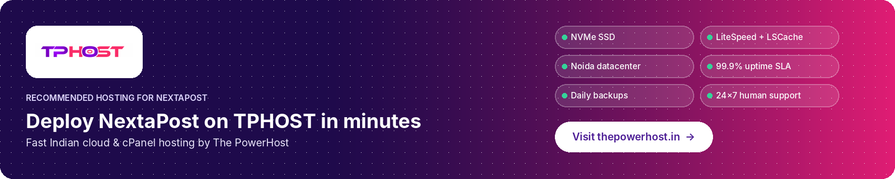</a>

## Features

| Area | What you get |
|---|---|
| **Content calendar** | Week / Month / List views, drag-and-drop rescheduling, unscheduled-drafts panel, "now" line, per-workspace time zone, keyboard shortcuts (← → T N) |
| **Post composer** | One text for all channels plus per-channel edits, live character counters per network (X counts links as 23), media upload and library, live post preview, Post now / Schedule / Draft / Submit for review |
| **Documents & carousels** | Upload **PDF, PowerPoint (PPTX) or Word (DOCX)** and post it as a swipeable document on LinkedIn (profiles and Pages), or as a file on Telegram and Discord. Different media per channel in one post (e.g. the PDF for LinkedIn, slide images for Instagram) |
| **Social networks** | Facebook Pages (posts, Reels, Stories), Instagram (feed, carousel, Reels, Stories, with or without a Facebook Page), LinkedIn profiles and company Pages, X/Twitter (with polls), TikTok, YouTube (videos and Shorts), Pinterest, Threads, Google Business Profile, WordPress, Telegram, Discord, Mastodon, Bluesky, plus a Sandbox test channel |
| **Posting times & queue** | Weekly posting times per channel with suggested times; "Add to queue" gives each channel its next free slot. Recurring posts (daily, weekly, monthly, yearly) |
| **Ideas & feeds** | Ideas board with columns and drag and drop, "turn into post", and an inbox of new articles from RSS, Atom and JSON feeds that can become ideas automatically |
| **Repurpose** | New Instagram or Threads posts are copied to the channels you choose, e.g. every Reel to TikTok, YouTube Shorts and Facebook |
| **Comment-to-DM flows** *(optional, off by default)* | Someone comments a keyword on your Instagram or Facebook post: NextaPost replies under the comment, sends them a DM with a button, can check that they follow you, then sends your link. Tracked clicks, activity log, viral-post queue that respects Meta's limits. Uses Meta's official API; no per-contact fees |
| **Labels, signatures & templates** | Colour-code posts by campaign or client and filter the calendar; reusable hashtag/CTA blocks; templates for posts you write every week |
| **Team notes** | Comments on each post with @mentions and email notifications |
| **Analytics** | Likes, comments, shares and views fetched for 30 days after publishing, shown per channel |
| **Media sources** | Add images from Unsplash, Canva designs, Google Photos and Google Drive, or import from a link |
| **AI writing assistant** | Bring your own key (OpenAI, Anthropic, Gemini or any OpenAI-compatible service): write from an idea, rephrase, change tone, shorten, translate, fit a channel's limit, hashtags, image alt text, brand voice per workspace |
| **AI agents (MCP) & REST API** | MCP server with 57 tools, REST API, API keys, OAuth 2.1 sign-in for apps, signed webhooks with retries and replay. See [docs/API.md](docs/API.md) |
| **Languages** | 18 interface languages per user (Hindi and Bengali complete, Arabic right to left); fill missing text with your AI key in System → Languages |
| **Teams & agencies** | Unlimited workspaces (one per client or brand), roles (Admin, Editor, Contributor, Approver, Viewer), approval workflow with "request changes" notes, activity log |
| **Publishing engine** | Cron-driven job queue with atomic claims, automatic retries with back-off (1 / 5 / 15 min), partial-publish tracking, token refresh, channels flagged for reconnect on auth errors |
| **Light, dark & auto theme** | Saved per user |
| **Mobile responsive** | Phone-first list view, slide-out navigation, Write/Preview tabs in the composer, no sideways scrolling |
| **Web installer** | `/install` checks the server, creates the database tables and your admin account, then locks itself |
| **Auto-updater** | One-click or automatic updates, SHA-256 and Ed25519 signature checks, full backup first, automatic rollback |
| **Storage clean-up** | Optional, per workspace: delete images/videos of published posts after 30–365 days (the post text and links stay), old post history and unused uploads. Drafts and scheduled posts are never touched |
| **Privacy** | Erase a person's account, activity-log IPs kept 90 days, deleted workspaces purged after 30 days |
| **Backups** | Code + `.env` + full SQL dump, downloadable from System → Backups |
| **Security** | Audited (see [SECURITY-AUDIT.md](SECURITY-AUDIT.md)): CSP with nonces, CSRF on every write, Argon2id passwords, session timeouts, rate limits, SSRF guard, encrypted tokens, upload content checks, signed updates |

## Screenshots

> Real screenshots of NextaPost with demo data. Each one follows your GitHub theme: switch GitHub to dark mode to see the dark theme.

### Content calendar: week view
Plan the whole week across every channel. Colour-coded status shows what's published, scheduled, in review or failed, and you can drag a post to reschedule it.

<picture>
  <source media="(prefers-color-scheme: dark)" srcset="docs/screenshots/calendar-week-dark.png">
  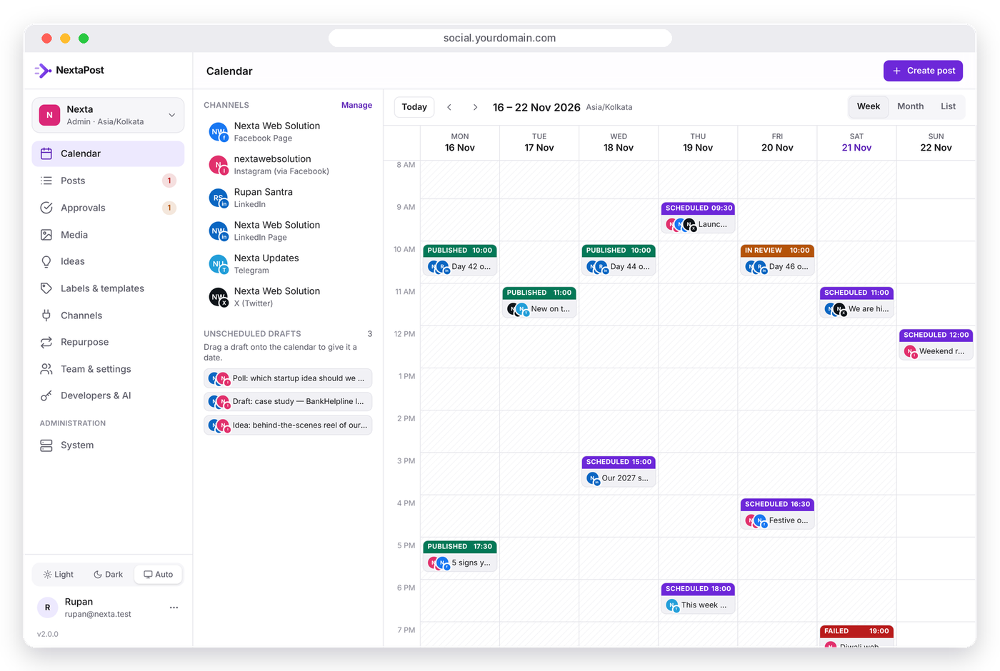
</picture>

### Month view
<picture>
  <source media="(prefers-color-scheme: dark)" srcset="docs/screenshots/calendar-month-dark.png">
  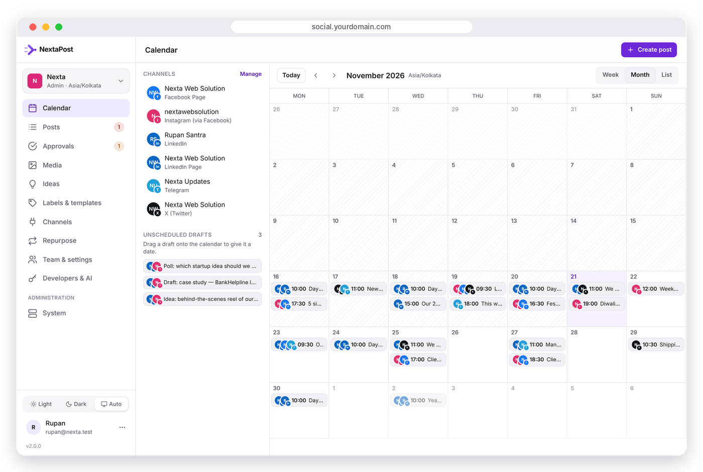
</picture>

### Post composer with live preview
Write once, tailor per channel, and see exactly how the post will look before it goes out.

<picture>
  <source media="(prefers-color-scheme: dark)" srcset="docs/screenshots/composer-instagram-dark.png">
  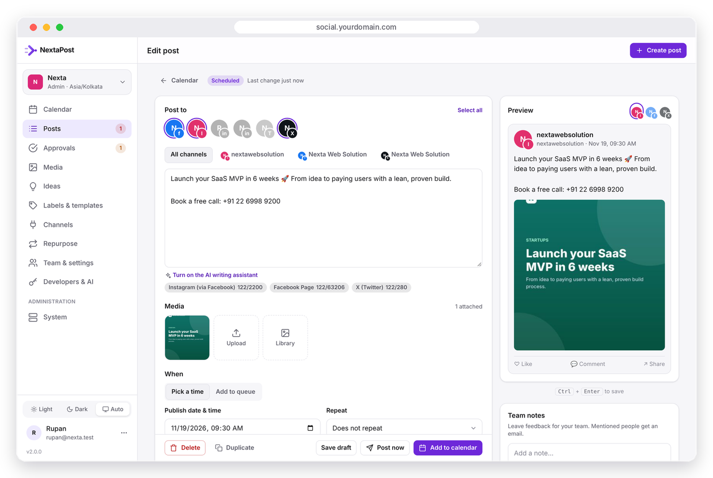
</picture>

### LinkedIn PDF carousel (document post)
Attach a PDF or PPTX and LinkedIn shows it as a swipeable slide carousel. Works on personal profiles and company Pages.

<picture>
  <source media="(prefers-color-scheme: dark)" srcset="docs/screenshots/composer-document-dark.png">
  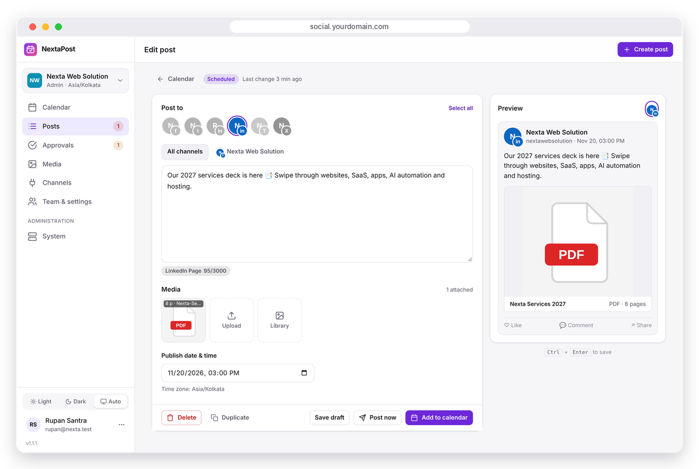
</picture>

### Works on your phone
<picture>
  <source media="(prefers-color-scheme: dark)" srcset="docs/screenshots/mobile-dark.png">
  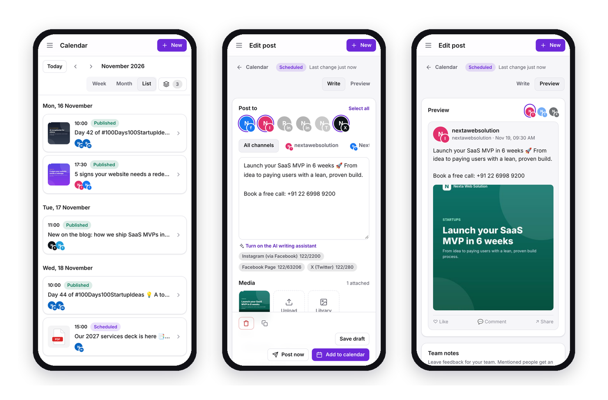
</picture>

<details>
<summary><b>More screenshots: posts, media library, channels, team, system, installer</b></summary>

#### All posts with status filters
<picture>
  <source media="(prefers-color-scheme: dark)" srcset="docs/screenshots/posts-dark.png">
  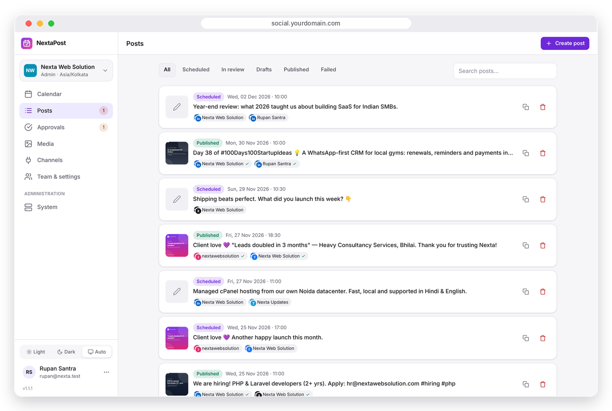
</picture>

#### Media library with images and documents
<picture>
  <source media="(prefers-color-scheme: dark)" srcset="docs/screenshots/media-dark.png">
  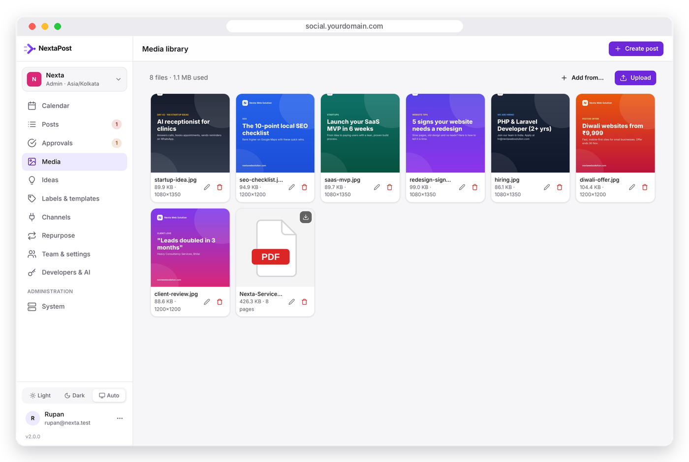
</picture>

#### Connected channels
<picture>
  <source media="(prefers-color-scheme: dark)" srcset="docs/screenshots/channels-dark.png">
  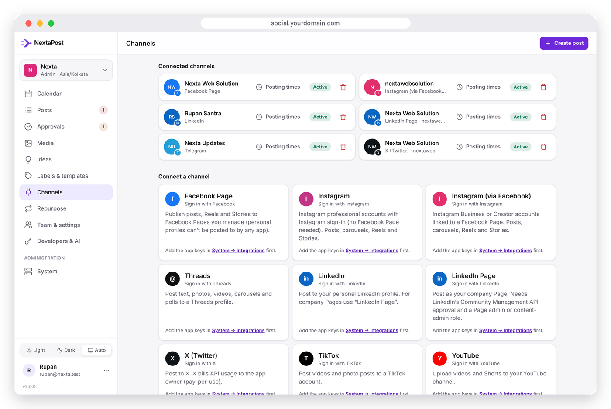
</picture>

#### Team roles and approval rules
<picture>
  <source media="(prefers-color-scheme: dark)" srcset="docs/screenshots/settings-dark.png">
  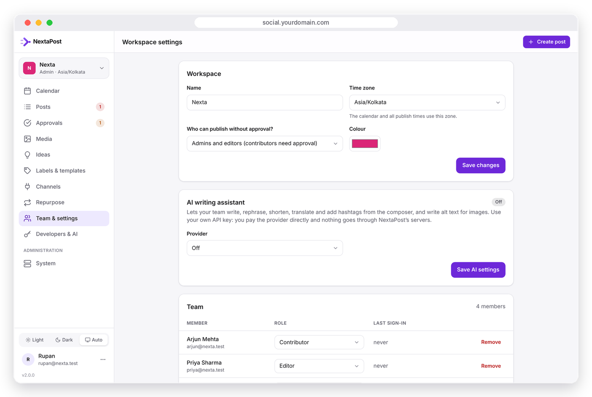
</picture>

#### System settings, updates and backups
<picture>
  <source media="(prefers-color-scheme: dark)" srcset="docs/screenshots/system-dark.png">
  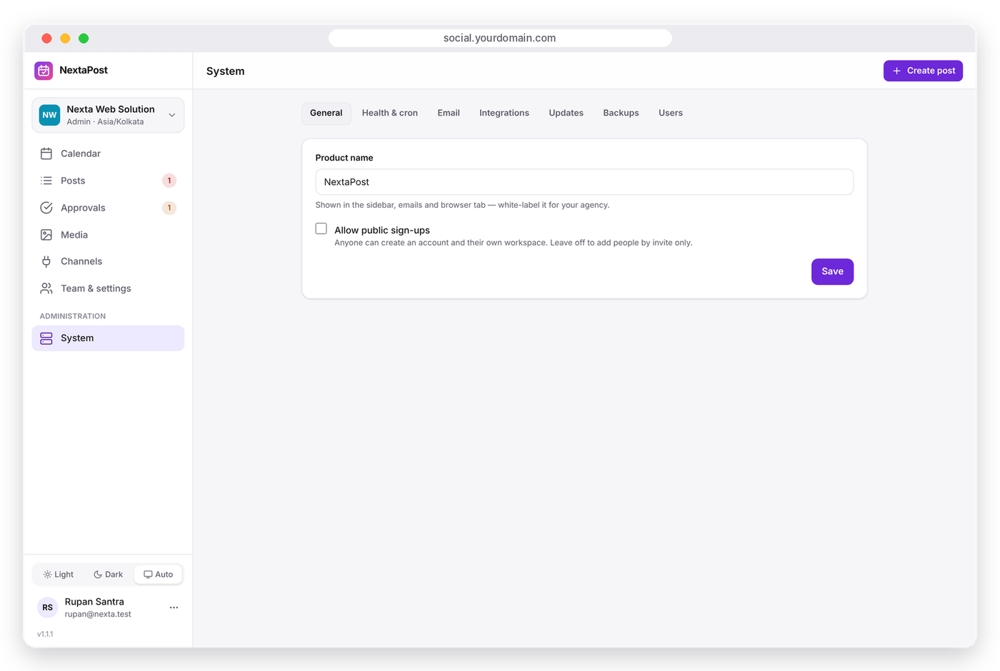
</picture>

#### Web installer
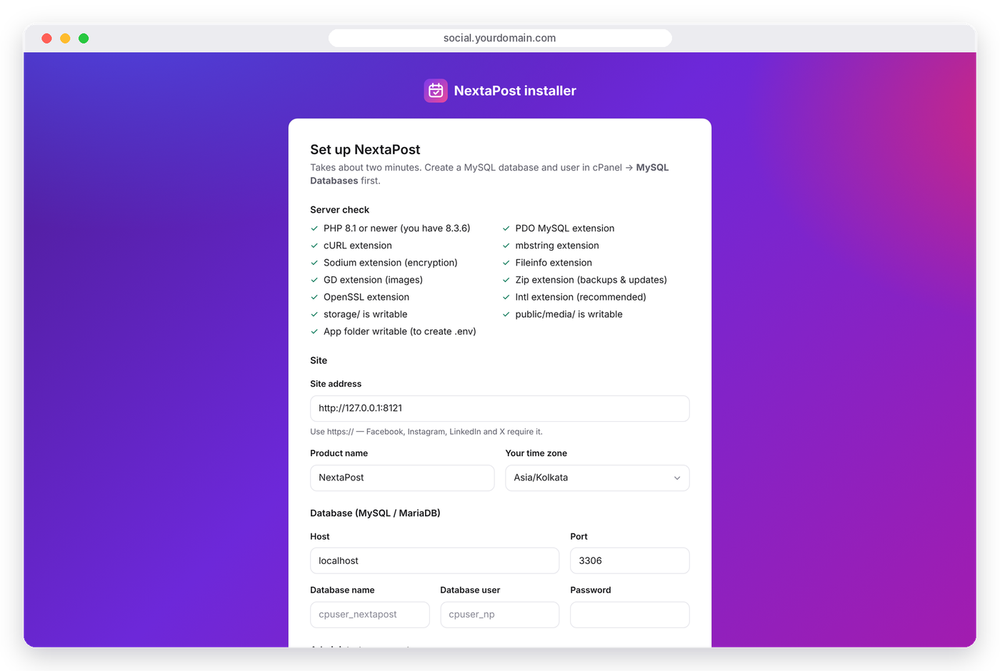

</details>

## Supported social networks

| Network | Images | Video | Documents (PDF/PPTX/DOCX) | For a "slides" post |
|---|---|---|---|---|
| **LinkedIn** profile & company Page | up to 20 | 1 | **Yes**: 1 file, up to 100 MB / 300 pages, shown as a swipeable carousel | Upload the PDF or PPTX |
| **Instagram** | carousel up to 10 | Reels | No (Meta's API has no document posts) | Export slides as images (1080×1350) → carousel |
| **Facebook** Page | up to 10 | 1 | No (Meta's API has no document posts) | Export slides as images → multi-photo post |
| **X (Twitter)** | up to 4 | 1 | No | Up to 4 slide images |
| **Telegram** | album up to 10 | 1 | **Yes**: sent as a file, up to 50 MB | PDF as a file, or images as an album |
| **Discord** | up to 10 | 1 | **Yes**: attached file, up to 10 MB | PDF attachment |
| **Mastodon / Bluesky** | 4 | 1 | No | Up to 4 slide images |
| **Threads** | carousel up to 20 | 1 | No | Slide images as a carousel |
| **Pinterest** | carousel pin 2–5 | 1 (video pin) | No | Images as a carousel pin |
| **TikTok** | photo post up to 35 | 1 | No | Slide images as a photo post |
| **YouTube** | — | 1 (video or Short) | No | Export as a video |
| **Google Business Profile** | 1 | — | No | One image per update |
| **WordPress** | featured image | — | No | Link to the PDF in the post |

When a post has a document and also a channel that can't take documents, the composer names that channel and lets you give it its own media with one click. Documents are stored outside the public folder, so only signed-in members of the workspace can download them. Files with scripts, macros, embedded files, passwords or remote templates are refused.

## Requirements

- PHP **8.1+** (8.3 recommended) with: `pdo_mysql`, `curl`, `mbstring`, `sodium`, `fileinfo`, `gd`, `zip`, `openssl` (+ `intl` recommended)
- MySQL **5.7+** or MariaDB **10.3+**
- HTTPS (AutoSSL). Facebook, Instagram, LinkedIn and X require it.
- A cron job that runs every minute

Need hosting? **[TPHOST](https://thepowerhost.in/?utm_source=github&utm_medium=readme&utm_campaign=nextapost)** cPanel plans include everything above (NVMe SSD, LiteSpeed, free SSL and cron jobs).

## Install on cPanel (about 5 minutes)

Choose one layout:

| | **A. Recommended: document root = `public/`** | **B. Simple: everything in `public_html`** |
|---|---|---|
| How | Extract to `~/nextapost/`, point the domain or subdomain document root to `~/nextapost/public` | Extract the *contents* of `nextapost/` straight into `public_html` (or a subdomain folder) |
| URLs | `https://social.yourdomain.com/login` | Same clean URLs; the root `.htaccess` sends requests to `public/` internally |
| Security | `.env`, backups, logs and code sit **outside** the web root | Protected by `.htaccess` deny rules only. Safe on Apache/LiteSpeed (cPanel); **don't use on Nginx** |

1. **Create a subdomain**, e.g. `social.yourdomain.com` (layout A: set its *Document Root* to `nextapost/public`).
2. **Upload** the zip with File Manager and **Extract** it.
3. **Create a database:** cPanel → *MySQL Databases* → create a database and a user, then add the user to the database with **ALL PRIVILEGES**.
4. **Select PHP 8.1+:** cPanel → *Select PHP Version* (or *MultiPHP Manager*) and enable the extensions listed above.
5. Open `https://social.yourdomain.com/` and follow the **installer**.
6. **Add the cron job:** cPanel → *Cron Jobs* → *Once Per Minute* → command:
   ```
   /usr/local/bin/php /home/CPANELUSER/nextapost/bin/cron.php >/dev/null 2>&1
   ```
   (System → Health shows the exact command with your path.)
7. Sign in → **Channels** → connect a channel (try *Sandbox* first) → **Create post**.

Keep `APP_DEBUG="false"` and use HTTPS. The installer only accepts a **local** database; to use a remote database server, create an empty file `storage/allow-remote-db` first. Optional: System → **Email** (SMTP for password resets and invites) and System → **General** (white-label product name, public sign-ups).

## Connecting the big networks

Create a developer app on each network and paste its keys in **System → Integrations**. Each card shows the exact *Redirect URL* to add to the app.

| Network | Developer app | Notes |
|---|---|---|
| Facebook Pages + Instagram | developers.facebook.com → Business app → *Facebook Login for Business* + Instagram Graph API | Needs **Meta App Review** for `pages_manage_posts` and `instagram_content_publish`. Instagram must be a Business/Creator account linked to a Page. Media must be reachable over HTTPS. |
| LinkedIn (profile) | linkedin.com/developers → *Share on LinkedIn* + *Sign In with LinkedIn (OpenID Connect)* | Self-serve. Tokens last 60 days. |
| LinkedIn Page (company) | A **second** app linked to your company Page → request *Community Management API* | LinkedIn review required. The person connecting must be a Page super admin or content admin. |
| X (Twitter) | developer.x.com → OAuth 2.0, Web App, read + write | X bills API usage to your developer account. |
| Instagram (without a Facebook Page) | developers.facebook.com → app with *Instagram API with Instagram Login* | Needs Meta App Review for `instagram_business_content_publish`. Professional (Business/Creator) account. |
| Threads | developers.facebook.com → app with the *Threads API* use case | Needs Meta App Review to post for accounts other than the app's testers. |
| TikTok | developers.tiktok.com → app with *Login Kit* + *Content Posting API* (Direct Post) | Until TikTok **audits** the app, posts can only be private (“Only me”). |
| Pinterest | developers.pinterest.com → app | Trial access posts to a sandbox; request **Standard access** to post live. |
| YouTube | console.cloud.google.com → OAuth client (Web) + *YouTube Data API v3* | Default quota is about 6 uploads a day; request more in Google Cloud. |
| Google Business Profile | Same Google OAuth client + the *Business Profile* APIs | Google must approve your project for the Business Profile API first. |
| WordPress | No app: in WordPress create an *Application Password* (Users → Profile) | The site must use HTTPS. |
| Telegram / Discord / Mastodon / Bluesky | No app review: bot token, webhook, access token or app password | |

## AI assistants, API and webhooks

Every workspace has a **Developers & AI** page.

- **Connect an AI assistant (MCP):** add `https://your-site/mcp` as a custom connector in Claude, ChatGPT or another MCP app, sign in to NextaPost and pick the workspace. The assistant gets the same access as you, or less, and approvals still apply. Try: “Plan three posts for next week about our Diwali offer and send them for approval.”
- **REST API:** create an API key and send it as `Authorization: Bearer np_…` to `https://your-site/api/v1`. Works with Zapier, Make, n8n and your own scripts.
- **Webhooks:** get a signed HTTPS request when a post is created, scheduled, approved, published or fails.
- **AI writing assistant:** in Team & settings, add your own OpenAI, Anthropic, Gemini or OpenAI-compatible key. You pay the provider directly; nothing goes through Nexta's servers.

The full reference for all 57 operations, the endpoints and webhook signatures is in **[docs/API.md](docs/API.md)**.

## Comment-to-DM flows (optional)

The “comment LINK and I'll DM you” automation, built in. It is **off by default** and hidden everywhere until a super admin turns it on in **System → General → Optional features**.

**How a flow runs:** someone comments your keyword → NextaPost posts a public reply under the comment (picked at random from your list) → sends them a DM with a button → when they tap it, Instagram checks whether they follow you (optional; if not, they get a *Visit profile* and an *I'm following* button) → they get your link as a button. Clicks are counted. Each person gets a flow once, and a flow can listen to all posts or only the posts you pick.

<picture>
  <source media="(prefers-color-scheme: dark)" srcset="docs/screenshots/comment-dm-dark.png">
  
</picture>

**Setup (once):**

1. Turn the feature on in **System → General**.
2. In your Meta app (the same one you use to connect Instagram/Facebook), open **Webhooks** and add the *Callback URL* and *Verify token* shown on the **Comment-to-DM** page. Subscribe to `comments`, `messages`, `messaging_postbacks` (Instagram) and `feed`, `messages`, `messaging_postbacks` (Facebook Page).
3. Reconnect each Instagram account or Facebook Page in **Channels**, so it grants the messaging permission (`instagram_business_manage_messages`, or `instagram_manage_messages` / `pages_messaging` with Facebook Login). The extra permissions are only requested while the feature is on.
4. On the **Comment-to-DM** page, press **Turn on DMs** for each account, then create a flow.

**Meta's rules, which NextaPost follows:** one private reply per comment, within 7 days; up to 750 private replies an hour per account (NextaPost queues above 700, so a viral post never gets dropped); the follow check only works after the person taps a button, which is why the button step comes first. Facebook Pages have no follow check. For an app that only serves accounts you own or manage, Meta's *Standard Access* is enough and no App Review is needed; agencies connecting client accounts need *Advanced Access* (App Review and business verification). Your site must be on HTTPS so Meta can deliver webhooks. Optional `.env` setting: `DM_PRIVATE_REPLIES_PER_HOUR` (default 700).

Activity (names and comments of the people who commented) is kept for 90 days.

## Languages

Each person chooses their language under **Your account**: English, हिन्दी (Hindi), বাংলা (Bengali), العربية (Arabic, right to left), Deutsch, Ελληνικά, Español, Français, Italiano, 日本語, 한국어, Nederlands, Polski, Português, Русский, Türkçe, Українська and 简体中文. Hindi and Bengali are complete. The other languages cover the screens you use every day; rarer text shows in English until it is translated.

**System → Languages** shows how complete each language is and can fill the missing text with the AI key of one of your workspaces. Those translations, and any you write yourself in `storage/lang/<code>.php`, are kept when you update.

## Updates

**System → Updates** checks your update server. An update:

1. downloads the package over HTTPS and verifies its **SHA-256** (and **Ed25519 signature** when a public key is set)
2. writes a full **backup** (code + `.env` + database) to `storage/backups`
3. puts the site in maintenance mode, replaces files and updates the database
4. **rolls back automatically** if anything fails

It never touches `.env`, `.htaccess` files, `storage/` or `public/media/`. You can also upload a .zip in System → Updates, or run `php bin/console.php update package.zip`.

Updating by copying the files yourself (File Manager, FTP, git) also works: keep `.env`, the `.htaccess` files and `storage/`, overwrite the rest, and the database is brought up to date on the next page load. Take a backup first.

<details>
<summary><b>Update server contract and publishing a release</b></summary>

```
GET /api/v1/check?product=nextapost&version=1.1.0&channel=stable&php=8.3.6&site=<hash>&license=<key>
200 {
  "update_available": true,
  "version": "2.1.0",
  "released_at": "2026-11-18",
  "notes": "What's new…",
  "download_url": "https://updates.example.com/dl/nextapost-2.1.0.zip",
  "sha256": "<hex sha256 of the zip>",
  "signature": "<base64 Ed25519 signature of the sha256 hex string>",
  "min_php": "8.1"
}
```

```bash
php tools/keygen.php storage/keys            # once; keep update-signing.key secret
echo 2.1.0 > VERSION
php tools/build-release.php --key=storage/keys/update-signing.key --notes="Bug fixes"
# → dist/nextapost-2.1.0.zip + dist/nextapost-2.1.0.json (serve both from the update server)
```

Schema changes go into `database/migrations/YYYY_MM_DD_NNNNNN_name.sql` (MySQL syntax). They're applied once and tracked in the `migrations` table.
</details>

## Command line

```bash
php bin/cron.php                     # scheduler (cron, every minute)
php bin/cron.php --no-lock           # extra parallel worker on a VPS
php bin/console.php migrate
php bin/console.php create-admin you@example.com 'password' 'Your Name'
php bin/console.php reset-password you@example.com 'new-password'
php bin/console.php backup
php bin/console.php update dist/nextapost-2.1.0.zip
```

## Development

```bash
# Rebuild CSS after changing classes (Tailwind v4, needs Node only on your machine)
npm i tailwindcss@4 && node tools/build-css.mjs

# Local server + tests (SQLite, no network needed)
php -S 127.0.0.1:8090 -t public tests/router.php
bash tests/run.sh               # 748 integration + 24 updater checks (with MySQL column-length rules)
python3 tests/e2e.py http://127.0.0.1:8090   # Playwright browser test (needs an installed copy)
# More browser suites: e2e_v2, e2e_dev, e2e_oauth, e2e_ai, e2e_networks, e2e_repurpose, e2e_ideas,
# e2e_media_sources, e2e_i18n, e2e_dm (Comment-to-DM, start the server with NP_FAKE_META=/tmp/meta.log),
# plus tests/mcp_client.py and the qa_*.py checks (see each file's header for its arguments)
python3 tests/e2e_docs.py http://127.0.0.1:8090 deck.pdf   # documents + per-channel media (after adding a Mastodon channel named Masto)
php tests/security_setup.php > /tmp/sec.json && python3 tests/security_http.py http://127.0.0.1:8090 /tmp/sec.json   # 53 attack simulations
```

**Project structure:** `src/Core` (router, DB, sessions, crypto, mailer, translations), `src/Services` (posts, publishing, queue, worker, media, AI, API/MCP, OAuth, webhooks, ideas, feeds, repurpose, comment-to-DM, updater, backup, installer), `src/Providers` (one class per network), `src/Controllers`, `views/` (PHP templates), `lang/` (interface languages), `public/assets` (compiled CSS, Alpine.js components), `database/` (schema and migrations).

**Translations:** interface text is written in English inside `__('…')` (PHP) or `np.t('…')` (JavaScript). After adding text, run `php tools/i18n-extract.php --write` to update `lang/_keys.json` and the browser string list, then add translations to `lang/<code>.php`. `php tools/api-docs.php` regenerates `docs/API.md`.

**Adding a network:** create `src/Providers/YourNetworkProvider.php` extending `AbstractProvider` (implement `meta()`, `limits()`, `connect()` or the OAuth pair, and `publish()`), then register it in `ProviderFactory::MAP`.

## Troubleshooting

| Symptom | Fix |
|---|---|
| Yellow banner "scheduler cron job isn't running" | Add the cron job (step 6). System → Health → *Run scheduler now* to test. |
| Upload fails for big videos | Raise `upload_max_filesize` and `post_max_size` in cPanel → *MultiPHP INI Editor*. |
| Instagram "media could not be fetched" | The site must be HTTPS and publicly reachable, not behind a login or IP block. |
| Channel shows "Reconnect" | The token expired or was revoked: Channels → Reconnect. |
| 500 error | Check `storage/logs/app-YYYY-MM-DD.log` for the reference shown on the error page. |

## FAQ

**Is NextaPost a free alternative to Buffer or Hootsuite?**
It's a self-hosted social media scheduler: you install it once on your own hosting and pay no per-user or per-channel subscription. You only need developer apps from the networks themselves (and X bills API usage separately).

**Can I schedule LinkedIn company Page posts?**
Yes. Connect your LinkedIn company Page through the *LinkedIn Page* channel (needs LinkedIn's Community Management API approval) and schedule text, images, video or PDF carousels.

**Can I post a PDF carousel on LinkedIn?**
Yes. Upload a PDF, PPTX or DOCX (up to 100 MB / 300 pages) and NextaPost publishes it as a LinkedIn document post, which members swipe through like slides.

**Does it run on shared hosting without Docker or Node.js?**
Yes. It's plain PHP and MySQL, built for cPanel. The only server task is one cron job every minute.

**Which hosting do you recommend?**
Any cPanel host with PHP 8.1+, MySQL and cron jobs works. We recommend [TPHOST by The PowerHost](https://thepowerhost.in/?utm_source=github&utm_medium=readme&utm_campaign=nextapost) for fast Indian cPanel hosting from a Noida datacenter.

**Can my clients approve posts before they go live?**
Yes. Give them the *Approver* role in their workspace and set "Who can publish without approval" to require approval.

**Where is my data stored?**
In your own MySQL database and hosting account. Access tokens are encrypted, and uploaded documents are kept outside the public folder.

## Licence

Proprietary © Nexta Web Solution Pvt. Ltd. Bundled third-party components: Alpine.js (MIT, built from the official source) and Tailwind CSS (MIT, build-time only). Network names and logos belong to their owners.

---

<div align="center">

<p>
  <a href="https://nextawebsolution.com"><picture>
    <source media="(prefers-color-scheme: dark)" srcset="docs/brand/nexta-icon-dark.png">
    
  </picture></a>
</p>

**Built by [Nexta Web Solution](https://nextawebsolution.com)** · [LinkedIn](https://www.linkedin.com/company/nextawebsolution/)

<p>
  <sub>Hosting partner</sub><br>
  <a href="https://thepowerhost.in/?utm_source=github&utm_medium=readme&utm_campaign=nextapost">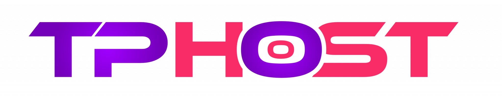</a>
</p>

<sub>Keywords: self-hosted social media scheduler, MCP server for social media, AI social media assistant, social media API, social media management tool, content calendar, PHP social media scheduler, Buffer alternative, Hootsuite alternative, Postiz alternative, LinkedIn scheduler, LinkedIn PDF carousel, Instagram scheduler, cPanel social media app, India cPanel hosting.</sub>

</div>
